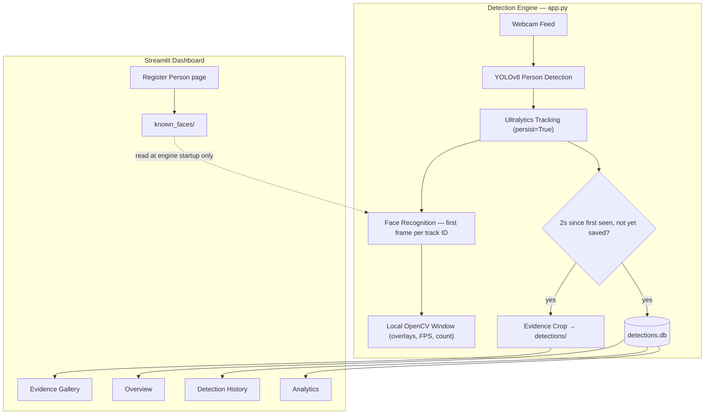
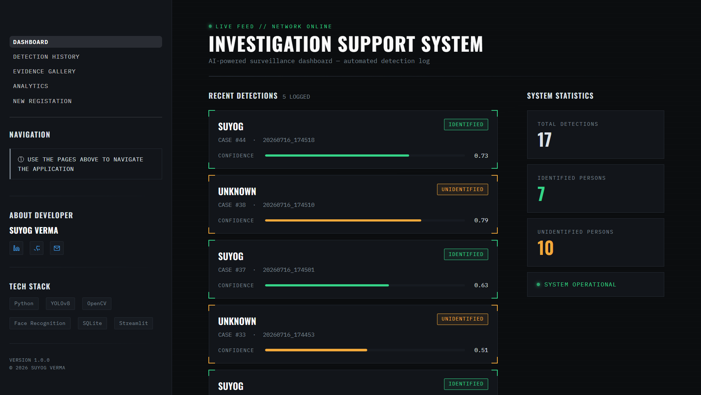
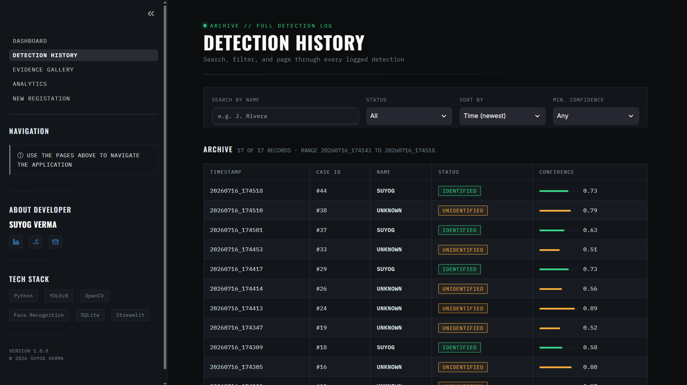
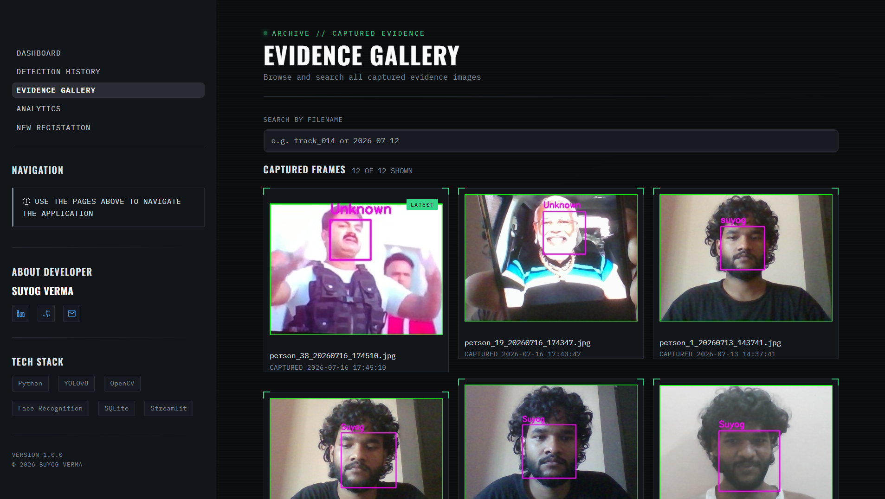
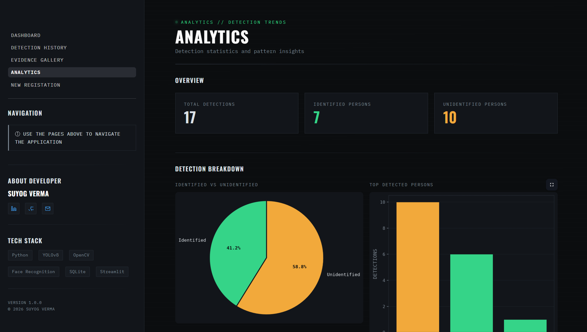
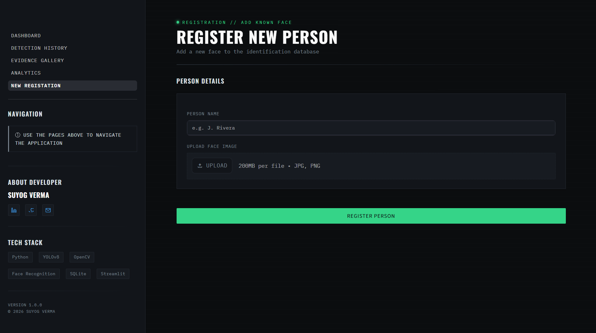

# Investigation Support System

**AI-powered surveillance pipeline for reviewing what a camera has seen.**

A local webcam feed is run through YOLOv8 for person detection, Ultralytics' built-in tracking for stable per-person IDs, and `face_recognition` for matching against a known-faces database. Every detection is logged to SQLite with an evidence snapshot, and a Streamlit dashboard lets you search, browse, and analyze that log after the fact.

[](https://www.python.org/)
[](https://github.com/ultralytics/ultralytics)
[](https://opencv.org/)
[](https://streamlit.io/)
[](LICENSE)
[](https://github.com/commit-msuyog/Investigation-Support-System/commits/main)

---

## Table of Contents

- [Why This Project](#why-this-project)
- [Key Features](#key-features)
- [How It Works](#how-it-works)
- [System Architecture](#system-architecture)
- [Core Modules](#core-modules)
- [Dashboard](#dashboard)
- [Database](#database)
- [Screenshots](#screenshots)
- [Project Structure](#project-structure)
- [Technology Stack](#technology-stack)
- [Installation](#installation)
- [Configuration](#configuration)
- [Known Faces / Person Registration](#known-faces--person-registration)
- [Usage](#usage)
- [Evidence Output](#evidence-output)
- [Limitations](#limitations)
- [Roadmap](#roadmap)
- [Development Notes](#development-notes)
- [Security & Ethical Considerations](#security--ethical-considerations)
- [AI Assistance Disclosure](#ai-assistance-disclosure)
- [Contributing](#contributing)
- [License](#license)
- [Author](#author)

---

## Why This Project

Passive CCTV monitoring produces hours of raw footage that nobody has time to watch. If you need to know "who showed up, when, and how confident are we about who it was," you're stuck scrubbing through video manually.

This project turns a live feed into a **structured, searchable log** instead: every person detected gets a tracking ID, a face-match attempt against a known-faces database, a timestamped database row, and a saved evidence image. Detection, recognition, and evidence capture happen once, automatically, while the feed runs — the dashboard is where that record actually gets reviewed afterward.

**For developers:** the system is two independent processes sharing a SQLite database and a folder of images. `app.py` is a plain OpenCV/YOLOv8 loop that never touches Streamlit; `dashboard.py` + `pages/` is a Streamlit app that never touches the camera. They don't need to run on the same machine or at the same time — the database and the `detections/` folder are the only handoff points.

---

## Key Features

| Feature | What it does |
|---|---|
| **Real-time person detection** | YOLOv8 (`yolov8n.pt`) detects people (COCO class `0`) in every frame, filtered to confidence > 0.5 |
| **Persistent multi-object tracking** | Ultralytics' built-in tracking (`model.track(..., persist=True)`) keeps a stable track ID per person across frames |
| **One-time face recognition per track** | The first crop of a new track ID is checked once against `known_faces/` via the `face_recognition` library; the result is cached for that ID |
| **Automatic evidence capture** | Once a track has been visible for 2 continuous seconds, its cropped image is saved to `detections/` exactly once |
| **SQLite detection logging** | Every saved evidence event is written to a `detections` table (track ID, name, confidence, image path, timestamp) |
| **Known-face registration UI** | Upload a name + photo from the browser to add someone to `known_faces/` |
| **Detection History** | Searchable, filterable, sortable, paginated log of every detection |
| **Evidence Gallery** | Filename-searchable image grid of every saved evidence crop, newest first |
| **Analytics dashboard** | Identified-vs-unidentified breakdown, top detected people, and a daily detection trend |

---

## How It Works

```
Camera Feed (webcam, index 0)
        │
        ▼
YOLOv8 Person Detection  (class "person" only, confidence > 0.5)
        │
        ▼
Ultralytics Tracking (persist=True → stable track ID per person)
        │
        ▼
Face Recognition (once per track ID, on that first cropped frame)
        │
        ├──▶ match found  → name assigned
        └──▶ no match     → labeled "Unknown"
        │
        ▼
2 seconds after a track first appears (once per track ID):
        │
        ├──▶ SQLite (detections.db): track_id, name, confidence, image_path, detected_time
        └──▶ Evidence crop saved to detections/
        │
        ▼
Streamlit Dashboard reads detections.db + detections/
(Overview · History · Evidence Gallery · Analytics · Register Person)
```

The Streamlit dashboard has **no live view of the camera** — the only live, annotated video feed is the local OpenCV window opened by `app.py`. The dashboard exclusively reads what's already been written to the database and the evidence folder.

---

## System Architecture



The two subgraphs run as **separate Python processes**. `detections.db`, `detections/`, and `known_faces/` are the only shared state between them — there is no direct function call or socket connection linking the engine and the dashboard.

---

## Core Modules

### 1. Person Detection
- **Model:** `models/yolov8n.pt` loaded through `ultralytics.YOLO`.
- **Input:** each webcam frame.
- **Filtering:** only COCO class `0` (person) is requested (`classes=[0]`), and detections with confidence ≤ 0.5 are discarded.
- **Output:** bounding boxes (`box.xyxy`) and a confidence score per detected person.

### 2. Object Tracking
- Tracking is invoked through Ultralytics' `model.track(frame, classes=[0], persist=True, verbose=False)`.
- No tracker configuration file (e.g. `tracker="botsort.yaml"`) is explicitly set in the code, so this project documents it as **Ultralytics' built-in multi-object tracking with `persist=True`**, which assigns and maintains a numeric track ID (`box.id`) for each person across frames — rather than naming a specific tracking algorithm.
- Detections with no assigned track ID yet (`box.id is None`) are skipped for that frame.
- The track ID is what drives caching (face recognition runs once per ID) and evidence de-duplication (one saved image per ID).

### 3. Face Recognition
- **Known faces** are loaded once at startup: every image in `known_faces/` is read with `face_recognition.load_image_file`, and one face encoding is computed per image (`face_recognition.face_encodings(image)[0]`).
- **Per-track recognition:** the first time a track ID is seen, its bounding-box crop is converted to RGB and passed to `face_recognition.face_locations(..., model="hog")`. If a face is found, its encoding is compared against every known encoding with `face_recognition.compare_faces` (library default tolerance).
- **Known vs. unknown:** if any comparison returns `True`, the person is labeled with the **first** matching name in the known-faces list (not the closest match by distance); otherwise they're labeled `"Unknown"`.
- The result is cached in memory for that track ID — recognition is **not** retried on later frames of the same track, even if a clearer face angle appears later.

### 4. Evidence Capture
- A per-track "first seen" timestamp is recorded the moment a track ID appears.
- Once **2 seconds** have elapsed since a track was first seen, and that track hasn't already been saved, its **cropped bounding-box region** (not the full frame) is written to `detections/person_{track_id}_{timestamp}.jpg`.
- Each track ID is saved **exactly once** per run of `app.py` (tracked via an in-memory `saved_ids` set).

### 5. SQLite Logging
`database.py` defines a single `detections` table and a `save_detection()` helper, called once per saved evidence image (see [Database](#database) for the schema). `create_database()` runs automatically whenever `database.py` is imported, so the table is created the first time `app.py` runs — there's no separate manual migration step.

### 6. Streamlit Dashboard
Five pages, detailed below in [Dashboard](#dashboard): **Overview** (`dashboard.py`), **Detection History**, **Evidence Gallery**, **Analytics**, and **Register Person** (all under `pages/`).

---

## Dashboard

| Page | What it shows | What you can do |
|---|---|---|
| **Dashboard** (`dashboard.py`) | Total detections, identified-persons count, unidentified-persons count, and the 5 most recent detections with confidence bars | Get a quick read on current activity |
| **Detection History** | Every logged detection in a paginated table (15/page) | Search by name, filter by identified/unidentified status, filter by minimum confidence, sort by time or confidence |
| **Evidence Gallery** | A 3-column grid of every saved evidence image, newest first, with capture timestamp | Search images by filename (e.g. a track ID or date substring) |
| **Analytics** | Identified-vs-unidentified pie chart, top-5 detected people bar chart, a daily detection count trend line, and a full per-person summary table | Spot patterns in who's being detected and how often |
| **Register Person** | A name field + image uploader with a live preview | Save a new face into `known_faces/` for the detection engine to pick up **next time it starts** |

All pages query `detections.db` directly and, where relevant, read image files from `detections/` — none of them communicate with `app.py` or the camera.

---

## Database

A single SQLite database, `detections.db`, with one table:

**`detections`**

| Field | Type | Purpose |
|---|---|---|
| `id` | `INTEGER` (Primary Key, autoincrement) | Unique row identifier |
| `track_id` | `INTEGER` | The Ultralytics tracking ID assigned to the detected person |
| `name` | `TEXT` | Recognized person's name, or `"Unknown"` |
| `confidence` | `REAL` | YOLOv8 detection confidence at the moment evidence was saved |
| `image_path` | `TEXT` | Relative path to the saved evidence crop in `detections/` |
| `detected_time` | `TEXT` | Timestamp string (`YYYYMMDD_HHMMSS`) when the evidence was captured |

There's just the one table — no foreign keys or joins, so no ER diagram is needed. `create_database()` in `database.py` runs at import time, so the schema is (re)created automatically whenever the module is imported.


---

## Screenshots

| Dashboard | Detection History |
|---|---|
|  |  |

| Evidence Gallery | Analytics |
|---|---|
|  |  |

**Register Person**



---

## Project Structure

```
Investigation-Support-System/
├── app.py                              # Detection engine: camera loop, YOLOv8, tracking, recognition, evidence
├── dashboard.py                        # Streamlit entry point — Overview page
├── database.py                         # SQLite schema + save_detection() helper
├── style.py                            # Shared CSS / design tokens injected into every page
├── requirements.txt                    # Core dependencies
├── requirements-gpu.txt                # CUDA-specific torch / torchvision build
├── detections.db                       # SQLite database (created automatically)
├── LICENSE
├── .gitignore
├── assets/                             # README screenshots
│   ├── dashboard.png
│   ├── history.png
│   ├── evidence-gallery.png
│   ├── analytics.png
│   └── register-person.png
├── models/
│   ├── yolov8n.pt                      # YOLOv8 nano weights (used by app.py)
│   └── haarcascade_frontalface_default.xml   # present in the repo, not referenced by any current code
├── pages/                              # Streamlit auto-discovers these as extra nav pages
│   ├── 1_Detection_History.py
│   ├── 2_Evidence_Gallery.py
│   ├── 3_Analytics.py
│   └── 4_New_Registation.py
├── ui/
│   └── sidebar.py                      # Shared sidebar: nav hint, developer info, tech pills
├── known_faces/                        # Registered face images (git-ignored, created at runtime)
└── detections/                         # Saved evidence crops (git-ignored, created at runtime)
```

---

## Technology Stack

| Technology | Purpose |
|---|---|
| **Python** | Core application language |
| **Ultralytics YOLOv8** (`ultralytics==8.4.90`) | Person detection and multi-object tracking |
| **OpenCV** (`opencv-python==4.10.0.84`) | Camera capture, frame handling, drawing overlays |
| **face_recognition** (`1.3.0`) + **dlib-bin** (`20.0.1`) | Face location, encoding, and comparison |
| **PyTorch** (`torch`, `torchvision`, CUDA `cu128` build) | Backend inference engine for YOLOv8 and `face_recognition`/dlib |
| **SQLite** (Python standard library) | Local detection log storage |
| **Streamlit** | Multipage dashboard UI |
| **Pandas** | Query results → DataFrames for the Analytics and export logic |
| **Matplotlib** | Pie, bar, and time-series charts on the Analytics page |
| **Pillow (PIL)** | Loading and displaying images in the Evidence Gallery and Register Person pages |
| **lap** (`0.5.13`) | Linear assignment solver used by Ultralytics' tracker |

Exact pinned versions are in [`requirements.txt`](requirements.txt) and [`requirements-gpu.txt`](requirements-gpu.txt).

> **Note:** `requirements.txt` does not currently list `streamlit`, `pandas`, or `torch`/`torchvision`, even though the dashboard imports `streamlit`/`pandas` directly and `ultralytics`/`face_recognition` depend on `torch` internally. Install these separately as described below.

---

## Installation

```bash
git clone https://github.com/commit-msuyog/Investigation-Support-System.git
cd Investigation-Support-System

python -m venv venv
```

Activate the environment:

```bash
# Windows
venv\Scripts\activate

# Linux / macOS
source venv/bin/activate
```

Install the core dependencies:

```bash
pip install -r requirements.txt
```

Install PyTorch (required by `ultralytics` and `face_recognition`/dlib, and **not** listed in `requirements.txt`):

```bash
# If you have a compatible NVIDIA GPU + CUDA toolkit:
pip install -r requirements-gpu.txt

# Otherwise, install a CPU build of torch/torchvision from pytorch.org
# and see the note in Limitations about app.py's hardcoded CUDA call.
```

Install Streamlit and pandas for the dashboard (also not listed in `requirements.txt`):

```bash
pip install streamlit pandas
```

The YOLOv8 weights (`models/yolov8n.pt`) and Haar cascade file are already included in the repository — no separate download step is required.

---

## Configuration

There is no `.env` file or config module in this project — the few configurable values are hardcoded constants in the source:

| Setting | Location | Current value |
|---|---|---|
| Camera source | `app.py` → `cv2.VideoCapture(0)` | Local webcam, index `0` |
| YOLO weights path | `app.py` → `YOLO("models\yolov8n.pt")` | `models/yolov8n.pt` |
| Detection device | `app.py` → `model.to("cuda")` | Hardcoded to GPU — see [Limitations](#limitations) |
| Person confidence threshold | `app.py` | `> 0.5` |
| Evidence delay | `app.py` | `2` seconds after a track first appears |
| Known faces folder | `app.py` → `known_faces_folder` | `known_faces/` |
| Evidence output folder | `app.py` | `detections/` |
| Database file | `database.py` → `DATABASE_NAME` | `detections.db` |

To change any of these (e.g. a different camera index, a larger YOLOv8 model, or a different confidence threshold), edit the relevant constant directly in `app.py`.

---

## Known Faces / Person Registration

- `known_faces/` holds one image per person. The **filename without its extension becomes the displayed name** (e.g. `known_faces/J_Rivera.jpg` → `"J_Rivera"`).
- Supported extensions: `.jpg`, `.jpeg`, `.png`.
- At startup, `app.py` loads every image in the folder and computes exactly one face encoding per image. Each image should contain **one clearly visible, front-facing face** — an image where no face can be detected will cause the startup loader to fail on that file.
- **Register Person page:** upload a name and a photo through the browser; it's saved directly to `known_faces/{name}.{extension}`. The page does not itself validate that a face is detectable in the photo — that only happens the next time `app.py` starts.
- **No hot-reload.** Known-face encodings are loaded once into memory when `app.py` starts. A person registered while the engine is already running will **not** be recognized until you stop and restart `app.py` — the Register Person page displays this reminder after every successful upload.

---

## Usage

1. **Start the detection engine:**
   ```bash
   python app.py
   ```
   This opens your webcam and a local OpenCV window titled "Investigation Support System," showing live bounding boxes, track IDs, confidence, FPS, and person count. Press `q` in that window to stop.
2. Every detected person above the confidence threshold gets a tracking ID from Ultralytics.
3. The first frame of each new track ID is checked once against `known_faces/`; the resulting name (or `"Unknown"`) is drawn on every subsequent frame for that track.
4. Once a track has persisted for 2 seconds, its cropped image is saved to `detections/` and one row is written to `detections.db`.
5. In a **separate terminal**, start the dashboard:
   ```bash
   streamlit run dashboard.py
   ```
   This does not require `app.py` to be running — it only needs `detections.db` to already exist (see the note in [Database](#database)).
6. Use the sidebar to move between **Dashboard**, **Detection History**, **Evidence Gallery**, **Analytics**, and **Register Person**.

---

## Evidence Output

- Evidence images are saved as `detections/person_{track_id}_{YYYYMMDD_HHMMSS}.jpg`.
- Each saved image is a **crop of the person's bounding box**, not the full camera frame.
- Exactly one evidence image is saved per track ID per run of `app.py`.
- Every saved image has a matching row in the `detections` table (see [Database](#database)), linked by `image_path`.

---

## Limitations

- **Single local webcam only.** `cv2.VideoCapture(0)` is hardcoded; there is no multi-camera or IP/RTSP camera support in the current code.
- **GPU required as shipped.** `app.py` hardcodes `model.to("cuda")` with no CPU fallback path — running it without a CUDA-capable GPU and a matching PyTorch build (see `requirements-gpu.txt`) will fail.
- **No live feed in the dashboard.** The Streamlit app only reads the database and the evidence folder; the only live annotated video is the local OpenCV window from `app.py`.
- **Face recognition runs once per track.** If the first captured angle is poor or the face is occluded, that person stays labeled `"Unknown"` for the rest of that tracking session, even if a clearer view appears later.
- **First-match, not best-match.** `face_recognition.compare_faces` uses its default tolerance and returns the first matching known face — not necessarily the closest one — when multiple known faces satisfy the threshold.
- **Known-face images must contain a detectable face.** An image with no detectable face can cause the startup loader in `app.py` to fail.
- **No hot-reload of known faces** — registering a new person requires restarting `app.py`.
- **Local SQLite file only** — no remote or cloud database.
- **No authentication** on the dashboard or the registration page — anyone with access to the running app can view evidence or register faces.
- **Lighting and face angle sensitivity**, inherent to the `face_recognition`/dlib pipeline.
- **No automated test suite** is currently included in the repository.

---

## Roadmap

**Implemented:**
- [x] Real-time person detection (YOLOv8)
- [x] Persistent multi-object tracking (Ultralytics, `persist=True`)
- [x] One-time face recognition per track
- [x] Automatic evidence capture
- [x] SQLite detection logging
- [x] Streamlit dashboard (Overview, History, Gallery, Analytics)
- [x] Known-face registration via the UI

**Planned / Future Scope:**
- [ ] Hot-reload known faces without restarting the detection engine
- [ ] Export detection history to CSV/PDF
- [ ] Basic email/webhook alert for repeated unknown-person detections
- [ ] Multi-camera / IP-camera support
- [ ] Live video feed inside the Streamlit dashboard, instead of only the local OpenCV window
- [ ] Authentication layer, if ever deployed in a multi-user setting

---

## Development Notes

A few implementation decisions worth calling out explicitly:

- **Detection and dashboard are deliberately separate processes.** The camera loop shouldn't be blocked by someone browsing the evidence gallery, and vice versa — SQLite and the filesystem are the handoff point, not a shared process or socket.
- **Face encodings are loaded once, at engine startup, for speed.** The trade-off is the no-hot-reload limitation described above.
- **Evidence images are files on disk, not database blobs.** This keeps `detections.db` small and lets the Evidence Gallery page work directly off the filesystem without touching the database for image bytes.

---

## Security & Ethical Considerations

This project performs face recognition against a local database of registered individuals. If you deploy or extend it:

- Use it only in **lawful, authorized environments** with appropriate consent from anyone being recorded or registered.
- Treat every "Identified" result as a **candidate match, not a confirmed identity** — `face_recognition.compare_faces` can produce false positives and false negatives, and the current implementation does not select the closest match when multiple known faces satisfy its tolerance.
- Human verification should back any decision made from a match — this system is a support tool for reviewing detections, not an automated identification authority.
- Evidence images and the SQLite database contain personal biometric and activity data; store, share, and retain them accordingly. There is currently no built-in data-retention policy, encryption, or access control — anything saved to `detections/` or `detections.db` persists indefinitely until manually removed.
- There is no authentication on the dashboard or the registration page in the current implementation, so anyone with access to a running instance can view evidence or register new faces.

---

## AI Assistance Disclosure

The detection pipeline, tracking integration, face-recognition logic, database schema, and overall application architecture were designed and implemented by the author. Claude was used to help refine and restyle the **Streamlit frontend** — moving from default Streamlit components to the current custom CSS design system, chart styling, and consistent page layout. The computer-vision pipeline, data model, and core application logic were not AI-generated.

---

## Contributing

1. Fork the repository.
2. Create a feature branch: `git checkout -b feature/your-feature`.
3. Make your changes.
4. Test locally (`python app.py` for the engine, `streamlit run dashboard.py` for the dashboard).
5. Commit with a clear message.
6. Push the branch and open a pull request.

---

## License

This project is licensed under the [MIT License](LICENSE).

---

## Author

**Suyog Verma**
GitHub: [@commit-msuyog](https://github.com/commit-msuyog)
LinkedIn: [linkedin.com/in/suyog01](https://www.linkedin.com/in/suyog01/)